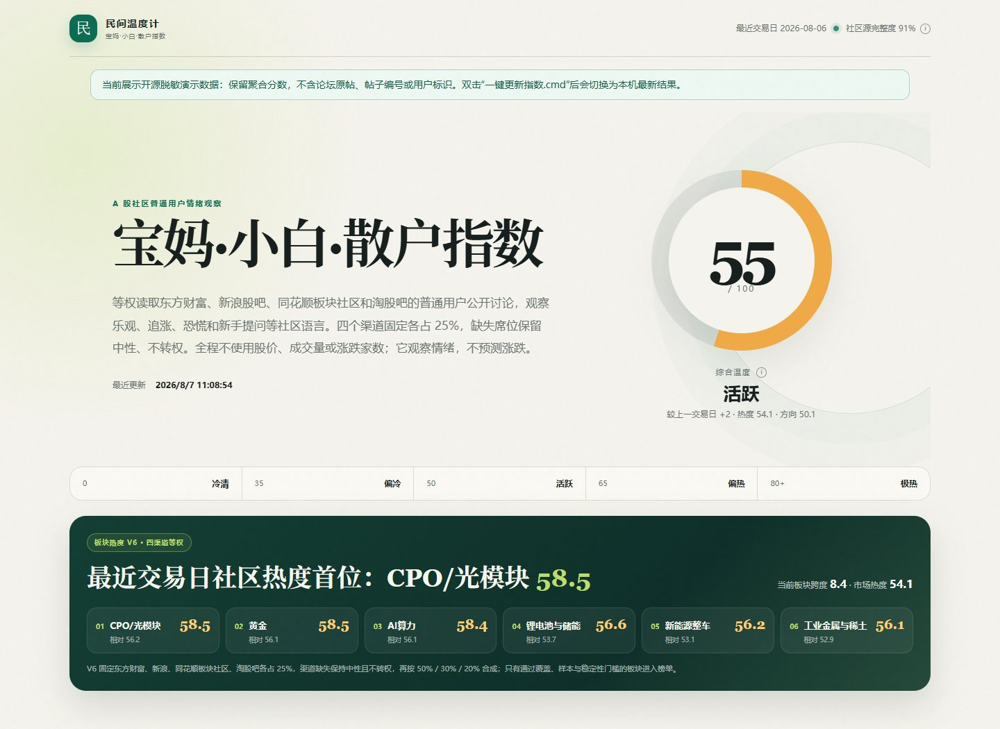

# 宝妈·小白·散户社区情绪指数

这是一个本地运行、每天一键更新的 A 股社区情绪仪表盘。它只分析普通用户公开讨论，不使用股价、成交量、换手率、涨跌家数、行情热榜或 RQ 数据。

> 开源仓库只发布原创代码、测试和脱敏聚合演示，不发布论坛原文、帖子编号、作者键、本地缓存、历史数据库或包含原帖摘录的截图。实际更新生成的数据始终留在使用者自己的电脑上。

当前版本包含：

- 综合指数：宝妈、小白、散户三个分指数等权平均；
- 宝妈指数：更关注社区乐观扩散、追涨冲动和讨论出圈；
- 小白指数：更关注“能买吗、怎么操作、成本和解套”等新手式表达；
- 散户指数：更关注普通用户整体方向、情绪强度与讨论活跃；
- 热度与方向：把“全市场冷热、板块相对关注、情绪躁动”和“主要偏多还是偏空”分开显示；
- 最近半年趋势：页面只按真实 A 股交易日展示最近六个月的总指数与三个分指数，不补周末或休市空点；
- 板块矩阵：8 个大类下设 30 个细分板块，CPO/光模块、PCB、AI算力、AI应用等不再混在一个宽泛“人工智能”板块里；
- 板块详情：点击任意板块，可查看边界说明、3 家典型公司示例、宝妈/小白/散户三大指数、六项社区信号、样本概况、平台拆分、公开来源和代表讨论；
- 公平审计：页面同时展示四个渠道各 25% 的固定席位、三个交易日固定权重、渠道正式影响与中性保留、证据可靠度、入口覆盖度和留一来源稳定区间；低置信板块保留数值供观察，但不生成硬排名。

## 公开托管主页

本分支用于发布 https://cavin2012.github.io/stock_indices/ 。GitHub Pages 只托管脱敏聚合快照，采集仍在本机执行，页面不是实时数据。配置与更新步骤见 [GitHub Pages 发布说明](docs/github-pages.md)。本项目基于 [原始开源项目](https://github.com/xzrd021/baoma-xiaobai-sanhu-zhishu) 改进，保留 MIT 许可证。

## 开源版快速开始

项目只依赖 Python 3.10 或更高版本的标准库，不需要安装第三方行情包、账号、Cookie 或 API Key。

- Windows：双击 `一键更新指数.cmd`；只看已有结果时双击 `打开最新结果.cmd`。
- macOS / Linux：在项目目录运行 `python update_index.py`，再用浏览器打开 `dashboard.html`。
- 直接打开刚克隆的仓库时，页面会自动读取 `data.example.js` 中不含原帖文字和用户标识的聚合演示；首次成功更新后自动优先显示本机 `data.js`。
- 运行测试：`python -m unittest discover -s tests`；发布前校验：`python validate_project.py`。

采集器只尝试无需登录即可访问的公开页面，不绕过验证码、登录、访问限制或反自动化措施。公开端点可能随平台调整而失效，程序会明确标记缺失并降低可靠度，而不是把失败伪装成真实零帖。

## 大盘来源补接（2026-11-26）

大盘社区现配置东方财富上证、深证、创业板三个指数吧，新浪对应的三个指数吧，以及同花顺上证指数讨论。新浪指数使用带交易所前缀的独立代码，避免把上证指数 sh000001 误识别为平安银行 sz000001；三个指数入口在新浪的 25% 渠道席位内等权。总采集入口由 308 个变为 311 个，个股板块入口保持独立，不重复计入大盘。

本次两轮匿名请求验证了新浪三个指数吧的公开论坛编号和游标分页。页内少于 50 条不再直接视为读完；只有空页确认结束，游标停滞或达到页数上限仍明确标记覆盖不完整。短时验证不保证未来长期可用，运行时继续记录来源失败与覆盖状态。

淘股吧的三个指数报价页虽能公开访问，但所带讨论最新时间分别停在 2026-10-29、2023-10-26、2026-07-27，没有近期有效样本；论坛首页混合个股与推荐内容，不能作为同口径替代。因此暂不接入淘股吧大盘来源，保留其 25% 中性席位并降低可靠度。雪球匿名讨论接口返回 HTTP 400，官方 robots.txt 限制 JSON 及相关自动采集路径，也暂不接入。详见 [来源验证记录](docs/market-source-validation.md)。

大盘来源结构变化使用新的 methodology：`community_text_four_channel_grassroots_three_trading_day_v4_sina_market_indices`。旧记录不改写成新口径；跨方法段不直接比较绝对值。同一天再次更新仍按原有规则覆盖当天记录。

## 三交易日证据补齐

日常更新先保存本轮原始结果，再将最近三个交易日、截至当前已经观测到的本地档案合并用于评分。按帖子编号和归一化正文去重，再执行每日作者限额；重复更新不累计重复样本。档案不改变原帖发布日期，不回写过去交易日的实测值，也不单独证明零帖。档案保留原文长度、营销/认证及评论时间继承标记；旧同花顺档案缺少过滤依据的内容不直接补入。

东方财富、新浪的六个大盘入口各自最多读取 30 页、45 秒，翻页间隔 0.25 秒；其他板块仍保持 3 页预算。大盘持续读取到第三交易日开始之前的时序边界，或明确读完来源；只读到第三天的一部分不视为完整。达到预算、游标停滞、重复页和中途失败均保留已有样本并标记不完整，不把缺失日期记成零。公开页面若有回复排序、置顶或截断，覆盖仍不等于全量普查。

页面新增“大盘证据覆盖”，分别显示各入口逐日有效样本、时序覆盖和档案补样数量。可靠度公式、四渠道各 25% 及三交易日 50%/30%/20% 不变。新方法标识为 community_text_four_channel_grassroots_three_trading_day_v5_archived_window。

## 每天怎么用

双击 `一键更新指数.cmd`。程序会自动：

1. 读取东方财富股吧、新浪股吧、同花顺板块社区和淘股吧的最新普通用户公开讨论；
2. 过滤资讯号、认证或机构作者、投顾内容、转发、广告、刷屏用户和重复文本，并降低长篇投研腔内容的影响；
3. 重新计算总市场及 30 个细分板块的三项指数；
4. 保存当日记录，并自动打开 `dashboard.html`。

不需要安装第三方 Python 库，不需要账号、Cookie 或 API Key。指数只生成 A 股交易日记录；周末或休市日点击时不会新增历史点，页面继续显示最近一个交易日。同一交易日重复点击只覆盖该交易日记录。若更新中断，45 分钟内再次点击会自动续用刚成功的来源，只补失败项。

## 数据来源与隐私

| 平台 | 自动计分内容 | 主要过滤 |
|---|---|---|
| 东方财富股吧 | 大盘指数吧和三家典型公司的普通用户公开标题 | 资讯号、财富号、转发、广告、刷屏与重复标题 |
| 新浪股吧 | 代表股公开论坛中的普通用户帖子 | 认证用户、广告、刷屏与重复文本 |
| 同花顺板块社区 | 概念板块及关联场景中通过审核的普通帖子与公开评论；只参与文本情绪 | 黄 V、身份标签、同顺号长文、投顾短观点、资讯、转发与营销作者 |
| 淘股吧 | 代表股公开讨论中的普通用户帖子和回复 | 认证身份、职业头衔、推广长文、多股营销、刷屏与重复文本 |

仪表盘和开源演示不会公开用户名或用户 ID。为完成去重、每位作者计入上限和中断续传，本地运行缓存可能暂存来源提供的作者键、帖子编号、短文本摘录、时间和公开互动计数；这些运行文件默认全部被 `.gitignore` 排除，只应留在本机，不应上传或再分发。每位作者在一次抓取中的计入条数有上限，防止单个刷屏账户控制指数。

雪球也做过可用性验证，但匿名自动访问会触发登录/WAF，且官方抓取规则限制相关自动路径。本项目不会绕过验证，因此雪球只作为人工核验入口，不自动计分。没有在上表列出的论坛不会被写成“已经接入”。

## 公平重构 V6：四渠道固定席位、渠道内等权、固定交易日

新版正式计算顺序固定为：**渠道 × 交易日校准 → 每个渠道内部等权合并预设入口 → 东方财富 / 新浪 / 同花顺 / 淘股吧各占 25% → 最近三个交易日按 50% / 30% / 20% 合成**。渠道席位与抓到的帖子多少无关，避免东方财富因为入口多、页面容量大而接管结果。

- 每个渠道、每个交易日单独做横截面校准。情绪方向、追涨、新手、恐慌和强度保留绝对文本含义，渠道内比较只用于修正语言风格和页面容量差异；讨论活跃只比较同一合格时序渠道当日的有效声量与独立参与广度；
- 四个渠道固定各占 25%。渠道内部的公司或板块入口等权合成；有效样本数只影响该入口的收缩幅度与可靠度，不会增加渠道的正式投票权；
- 缺失渠道、缺失入口和未观测交易日均保留中性席位并降低覆盖度，不把它的权重赠送给仍有数据的渠道、入口或日期；
- 同花顺公开入口是 `hot_feed` 热门流而非严格时序流，因此只提供普通用户文本情绪，不进入正式发帖声量、讨论活跃或交易日零帖核验；
- 普通评论、口语化表达、持仓感受和提问式表达优先；认证或机构身份直接过滤，长篇投研腔、跨多股推广和职业化表达过滤或降权。这是“普通用户 / 草根表达”的可审计代理，不推断作者智力、真实身份或投资能力；
- 最近三个交易日始终保持 50% / 30% / 20%，不会因为某天缺数据而把剩余日期重新放大；
- 所有可合成信号以 50 为日常中枢；恐慌是单独风险信号，不用 `100 − 恐慌` 给平静市场无条件加分；
- 公式先冻结再计算，不根据想要的市场热度或某个板块的主观印象临时加词、抬分或改权重。

整体市场同样使用固定席位：大盘社区 40%、板块社区 50%、偏热大类扩散面 10%。细分板块先在所属大类内按固定席位聚合，再让 8 个大类等权；缺失板块或大类席位保持中性并降低覆盖度。这样科技板块不会仅因拆得更细、来源更多或帖子更多，就机械地获得更高的整体市场权重。

## 板块热度 V6：渠道等权与低置信不硬排名

新版同时保留四个不同含义的量：

- **综合热度**：页面主数值。由四渠道等权后的讨论活跃和情绪温度形成，再结合全市场锚点与同日板块相对位置；
- **交易日相对热度**：回答“最近交易日 30 个细分板块里谁更受关注”，50 附近是同日可比较板块的中位；
- **绝对温度**：保留渠道等权后的讨论活跃和情绪温度，用于观察板块自身的连续变化；
- **情绪躁动**：由追涨、新手、强度和讨论活跃合成；情绪方向仍单独展示，所以高热不等于看多。

低样本会向 50 的中性中枢收缩并降低可靠度。系统同时检查渠道覆盖、渠道内入口覆盖、有效样本量以及“每次删除一个渠道或来源后结果变化多大”的稳定区间。没有达到门槛的板块仍显示 provisional 数值、原始证据和风险提示，但不会生成精确名次或用硬排序制造差异。页面里的留一来源稳定区间是敏感性范围，不是统计学置信区间。

历史曲线只沿真实 A 股交易日记录绘制。周末与休市日不生成新点，也不会用空点拉长横轴；更新程序只使用当时及此前可见数据，不读取未来帖子。交易日历在 2025、2026 年使用上交所公布的年度休市安排；其他年份若尚未内置官方安排，会明确标记为“工作日回退”，不会假装已经识别法定休市日。

## 三交易日观察窗口

当前窗口固定为最近三个 A 股交易日，由近到远按：

- 最近交易日：50%；
- 上一交易日：30%；
- 前两个交易日：20%。

页面会在板块详情中展示三交易日有效样本、逐交易日帖子数和加权帖子量。各平台公开页面覆盖能力不同，因此这些数字是程序实际取得并完成过滤、去重和作者限额后的有效社区样本，不冒充论坛完整普查。

缺失状态严格分为两类：

- **`verified_zero`（经核验零帖）**：只有严格按时间排列的来源完成头部到窗口边界的读取、抓取发生在收盘后、且最早原始时间已经越过该交易日时，程序才可以确认这一天确实没有合格帖子；它在声量中按真实 0 处理；
- **`unobserved`（未观测）**：抓取失败、翻页没有到达边界、缓存无法证明完整性或平台本身不是严格时序流时，程序只承认“不知道”，不会把它伪装成 0。同花顺 `hot_feed` 永远不参与零帖核验。

无论出现哪种缺失，页面和公平审计中的交易日席位仍是 50% / 30% / 20%。未观测日、缺失渠道和缺失入口保留中性席位并降低可靠度，不把权重转送给其它日期、入口或渠道。

历史回溯另有两道防偏处理，且不会改变交易日实测口径：

- `estimated` 先执行每位作者每天最多 3 条；稳定抽样键不读取情绪标签，补采翻页或输入顺序变化不会因为“最新 N 条”而系统性改写历史；
- 逐日帖子量只取对应交易日实际观察到的有效文本；只有满足完整性条件的日期才可记为经核验零帖，不把周末、休市或未观测日期硬补为 0，也不使用未来日期校准过去。

## 六个社区信号

| 信号 | 含义 |
|---|---|
| 情绪方向 | 看多与看空语言的软判定；50 附近多空均衡 |
| 追涨冲动 | 梭哈、满仓、上车、踏空、涨停、必涨等追涨表达；会识别“不要追高”等否定语境 |
| 恐慌风险 | 割肉、清仓、暴跌、跑路、爆仓、救命等恐慌表达；单独展示，不进入三指数加分项 |
| 新手提问 | 小白、新手、能买吗、怎么操作、成本、解套等求教式表达 |
| 情绪强度 | 极端方向词、连续感叹问号和高强度社区语言 |
| 讨论活跃 | 每个合格时序渠道、每个交易日先比较有效发帖声量与独立参与广度，再按四渠道固定席位及 50% / 30% / 20% 合成；同花顺热门流不进入此项 |

正式讨论活跃中，发帖声量占 85%、独立参与广度占 15%。点赞、评论、公开阅读量和同花顺热榜热度都不作为额外声量、公司席位或平台票数，避免平台推荐算法和事后互动主导热度。

## 三个分指数权重

| 信号 | 宝妈 | 小白 | 散户 |
|---|---:|---:|---:|
| 情绪方向 | 25% | 15% | 30% |
| 追涨冲动 | 25% | 20% | 20% |
| 新手提问 | 15% | 30% | 5% |
| 情绪强度 | 15% | 15% | 15% |
| 讨论活跃 | 15% | 15% | 20% |
| 板块扩散 | 5% | 5% | 10% |

高分表示普通用户社区更活跃、更乐观或更有追涨与新手参与特征，不代表之后会上涨。

项目还会在 diagnostics 中实验性统计三类互斥行为语料：家庭稳健型、明确提问型、主动交易型。仪表盘会在字段可用时展示三类表达证据的计数条和实验候选方向，字段缺失则自动隐藏。分群证据词会先被遮住再计算候选方向分，候选值只向市场基准收缩、不会人为放大差异。该实验目前只供审计，不替换上表的正式三指数；这些计数是表达风格证据，不识别作者的真实身份、性别、年龄或家庭情况。

## 板块指数

当前目录把 30 个细分板块归入 8 个大类：

| 大类 | 细分板块 |
|---|---|
| 科技与数字经济 | CPO/光模块、PCB、AI算力、AI应用、芯片设计、半导体设备材料、通信设备与运营、传媒游戏 |
| 高端制造与军工 | 机器人与自动化、航空航天军工 |
| 消费 | 白酒、食品饮料、家电 |
| 医药医疗 | 创新药、医疗器械 |
| 新能源与汽车 | 锂电池与储能、光伏、新能源整车、汽车零部件与智能驾驶 |
| 金融地产基建 | 银行、券商保险、房地产开发、基建央企 |
| 资源化工与公用 | 黄金、工业金属与稀土、基础化工、电力运营、电网设备 |
| 农业 | 生猪养殖、种业粮食 |

仪表盘可以按大类筛选，每张细分板块卡片都可以点击进入详情。详情里的“综合社区温度”表示讨论有多热、情绪有多明显；“情绪方向”单独表示讨论偏多还是偏空，两者都不代表股价强弱。每个板块展示 3 家“典型公司示例”，用于说明板块边界，不是指数成份股、完整公司名单或投资推荐。为避免重复抬高热度，每家公司固定一个主归类。

每个细分板块按四个渠道配置受控社区入口：

- 东方财富读取全部 3 家典型公司的股吧；
- 新浪读取全部 3 家典型公司的公开论坛；
- 同花顺读取与细分主题对应的概念板块社区及关联场景社区；
- 淘股吧读取全部 3 家典型公司的公开讨论。

细分主题不混入宽泛行业吧，避免大类帖子把 CPO、PCB、AI算力等差异重新拉平。东方财富、新浪和淘股吧都用同一组 3 家典型公司作为渠道内等权入口；同花顺使用细分板块社区而不是用单只股票代替整个板块。

正式顺序是：先在同一渠道、同一交易日校准，再在渠道内部等权合并预设入口，最后让四个渠道各占板块的 25%。帖子数量只决定证据可靠度与向中性收缩的程度；缺失渠道和入口席位保持中性。30 个细分板块在各自大类内使用固定席位，8 个大类再等权汇总，因此热门来源、额外入口和拆分较细的大类都不能接管别人的投票权。历史档案没有对应文本时会明确显示缺数据，不会把旧“人工智能”分数复制成多个新板块。

## 稳定性与失败回退

- 每个平台使用独立并发上限；同花顺保持低频 3 路读取；
- 东方财富出现“系统繁忙”时会有限重试，再尝试公开页面；
- 单个来源失败时使用 72 小时内的最后成功缓存；
- 至少需要三个渠道和足够多的新鲜来源才会写入新结果；
- 单个板块若渠道覆盖、证据可靠度或留一来源稳定性不足，仍可显示为低置信 provisional，但不进入正式热度排名；
- 网络整体不可用时保留上一版，不会生成一屏 0 分；
- 同一交易日重复更新只替换该交易日历史点；新交易日自动追加，周末与休市不新增点，页面滚动展示最近六个月，底层最多保留 365 个交易日记录。

## 文件说明

- `一键更新指数.cmd`：每天双击这个；
- `打开最新结果.cmd`：不重新联网，只用唯一地址打开磁盘上的最新页面，避免浏览器缓存旧结果；
- `dashboard.html`：本地仪表盘；
- `update_index.py`：社区采集、普通用户表达过滤、渠道×交易日校准、入口映射和结果生成；
- `channel_fairness_model.py`：无联网、无文件写入的四渠道公平聚合核心，负责渠道内入口等权、固定 25% 渠道席位、50% / 30% / 20%、中性收缩和可靠度诊断；
- `fairness_model.py`：旧公司等权口径的兼容与历史审计模块；
- `sector_catalog.py`：30 个细分板块、8 个大类、边界说明、典型公司与受控采集入口；
- `trading_calendar.py`：A 股交易日与休市日判断；
- `sector_heat.py`：板块热度 V6、渠道等权关注度、低置信排名门槛、相对热度与综合热度校准；
- `audit_sector_heat.py`：审计最近 60 个交易日的板块跨度、排名稳定性与三大正式指数不变性；
- `data.js`：网页读取的最新结果；
- `data.example.js`：开源仓库自带的脱敏聚合演示；不包含原帖文字、帖子编号或用户标识；
- `build_public_demo.py`：从本机最新结果生成可公开演示文件，并主动剔除帖子数组与身份字段；
- `data/latest.json`：最新结构化结果；
- `data/history.json`：新版交易日历史；
- `data/history_meta.json`：历史区间、实测/估算天数、连续区段和回溯来源说明；
- `data/history_60d.sqlite3`：用于构建最近 60 个交易日结果的公开社区历史样本库；
- `data/history_60d_report.json`：历史采集进度、来源状态和样本统计；
- `data/history_60d_build_report.json`：历史指数构建范围、覆盖度和写入结果；
- `data/community_archive/`：交易日更新保留的去身份化社区指标档案；
- `data/forum_cache.json`：公开文本短摘录缓存，用于失败补位；
- `data/sina_bid_cache.json`：新浪论坛编号缓存；
- `data/ths_forum_cache.json`：同花顺论坛映射缓存；
- `data/history_community_v3.json`：如存在，为旧社区公式历史备份；
- `data/history_market_v2.json`：如存在，为旧量价版本历史备份；
- `data/update.log`：更新记录和错误详情。

`refresh_latest_from_cache.py` 仅用于评分方法升级或网络临时不可用时，把最后一次完整缓存迁移到新口径；它不会冒充一次新的联网更新，日常无需点击。

回溯估算只使用当时及此前可见的公开帖子文本，不使用点赞、评论等事后互动量反推当日热度。仪表盘用虚线区分回溯估算与交易日实测；同一交易日同时存在两类记录时始终以实测为准。

四渠道固定席位 V6 会使用独立的方法标识，并从首次成功更新日形成新的历史方法段；此前保留的点属于旧方法段。页面会在方法变更处主动断开折线，断点两侧的绝对值不能直接比较，只能分别观察各方法段内部的变化。旧历史不会被伪装成 V6，也不会复制成新细分板块历史。

## 重要边界

“宝妈”“小白”“散户”是三种社区情绪观察角度，不是对真实用户性别、职业、年龄或投资经验的识别。透明词典和规则仍可能误判反讽、玩笑、隐语和长文中的复杂语境。这个工具适合观察连续趋势和板块间差异，不适合根据某一天的分数直接买卖，也不构成投资建议。

## 许可证与第三方内容

原创代码采用 [MIT License](LICENSE)。MIT 许可证不覆盖任何论坛用户内容、平台数据、平台商标或第三方接口；项目与东方财富、新浪、同花顺、淘股吧没有隶属、合作或授权关系。使用者应自行遵守相关网站条款、robots 规则、合理访问频率及所在地法律。详细边界见 [DISCLAIMER.md](DISCLAIMER.md)，贡献方法见 [CONTRIBUTING.md](CONTRIBUTING.md)，安全问题见 [SECURITY.md](SECURITY.md)。
